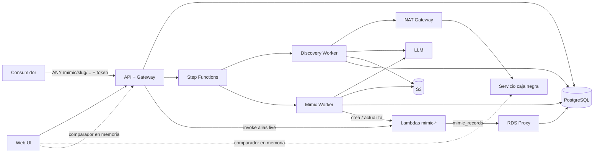
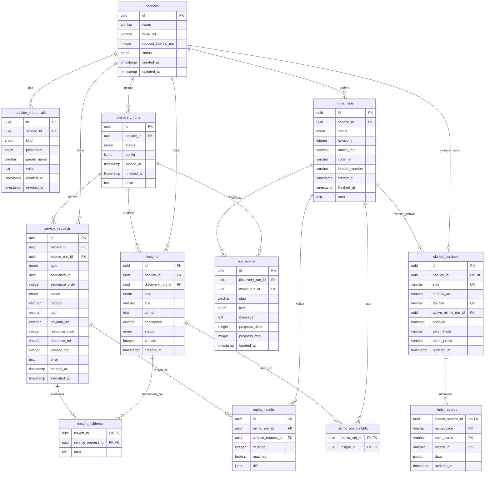

# Arquitectura de la solución

## 1. Objetivo

La plataforma debe descubrir el comportamiento de un servicio caja negra y generar
un reemplazo funcionalmente compatible. La arquitectura separa claramente:

- La transaccionalidad y consulta de estados.
- La ejecución de pruebas contra el servicio original.
- El razonamiento del agente y su registro como insights en texto.
- La persistencia de metadatos frente a payloads grandes.
- La generación, validación y habilitación del servicio clonado.

El flujo principal es:

`Configuración → Discovery → Insights → Mimic (use cases) → Replay → Ship (habilitar)`

El servicio clonado se compone de use cases ejecutados en Lambda. Las Lambdas no
guardan memoria entre invocaciones; el estado del servicio (cuentas, saldos,
movimientos, etc.) se persiste en **tablas virtuales sobre PostgreSQL** (sección
5.3). No se migra tráfico del original al clon; el clon se expone en una ruta propia
de la plataforma y se puede reemplazar o quitar en cualquier momento.

## 2. Vista general



## 3. Componentes

### 3.1 API transaccional

Es el punto de entrada para la UI. Sus responsabilidades son:

- Gestionar los servicios registrados y sus credenciales.
- Recibir ejemplos de requests ya validados por la UI (tabla o CSV).
- Iniciar, pausar, reanudar o cancelar un discovery.
- Iniciar y consultar el proceso de mimic.
- Consultar el progreso de los runs y el estado de cada request (`run_events`,
  `service_requests.status`).
- Consultar insights, evidencias y resultados de replay.
- Habilitar o deshabilitar un clon (ship) y regenerar su token de acceso.

La API no debe ejecutar directamente llamadas largas contra el servicio caja negra.
Debe crear un job idempotente y delegar la ejecución al orquestador.

La misma API actúa además como **gateway de los servicios clonados** (sección 5).

### 3.2 Máquina de estados

Se recomienda usar un orquestador durable, como AWS Step Functions, para representar
los procesos de discovery y mimic. Alternativamente puede implementarse con una tabla
de estados y workers (`SELECT ... FOR UPDATE SKIP LOCKED` en PostgreSQL).

Estados de discovery:

`CREATED → VALIDATING_INPUT → RUNNING → ANALYZING → REVIEW_REQUIRED → COMPLETED`

Estados de mimic:

`CREATED → GENERATING → REPLAYING → APPROVAL_REQUIRED → DEPLOYING → READY`

Estados alternativos para ambos: `PAUSED`, `FAILED`, `CANCELLED`.

`APPROVAL_REQUIRED` es un paso visual: la UI muestra el resultado del replay y el
usuario confirma; la aprobación no se persiste en una entidad aparte. `READY`
significa que la Lambda existe y está probada; el **ship** consiste únicamente en
marcar el clon como habilitado en `cloned_services` para que el gateway lo exponga.

Cada transición y cada paso relevante se registra en `run_events` (sección 4.6),
que es la fuente para mostrar el progreso en la UI. Las transiciones deben ser
idempotentes para evitar duplicar trabajos o despliegues.

### 3.3 Discovery Worker

Es un worker aislado que ejecuta las pruebas contra el servicio original. Debe:

- Leer la configuración, credenciales y ejemplos del servicio.
- Ejecutar requests de forma secuencial, con timeout y una pausa configurable entre
  operaciones (`services.request_interval_ms`) para no saturar el servicio original.
- Actualizar el `status` de cada `service_request` (`pending → running → completed`
  o `failed`) y registrar el avance en `run_events`.
- Capturar request, response, headers permitidos, latencia y errores.
- Guardar el payload crudo en S3.
- Enviar al LLM únicamente el contexto necesario, con redacción de credenciales.
- Registrar insights en texto.

El worker se ejecuta en subredes privadas con salida por NAT Gateway. Se deben
aplicar allowlists, bloqueo de rangos privados y protección contra SSRF antes de
realizar cualquier request a la URL registrada.

### 3.4 Insights del agente

Los insights son **texto claro y resumido escrito por el agente**, no reglas en un
esquema rígido. El comportamiento posible de un servicio es demasiado amplio para
capturarlo en un DSL; el texto conserva el razonamiento y es lo que consume el
generador de código.

Ejemplo de insight:

> API bancaria con dos verbos (GET y POST). Bajo POST existen cuatro operaciones
> anidadas en `/accounts/{id}/...`: `transfer`, `freeze`, `validate` y `limits`.
> `transfer` rechaza montos ≤ 0 con 422 `INVALID_AMOUNT` y montos mayores a 10.000
> con 403 `LIMIT_EXCEEDED`. Los IDs de cuenta tienen 10 dígitos; otro formato
> devuelve 400.

Cada insight tiene un tipo, un nivel de confianza, un estado de revisión y queda
relacionado con las `service_requests` que lo sustentan. El LLM no es la fuente
primaria de verdad: la evidencia son las requests y responses capturadas.

### 3.5 Mimic Worker

Convierte los insights en un servicio ejecutable:

1. Toma los insights validados del servicio y, por cada operación, algunos pares
   request/response reales. Los insights usados quedan registrados en
   `mimic_run_insights`.
2. El agente generador escribe **únicamente use cases** sobre una plantilla fija.
3. Se ejecuta el replay de las `service_requests` contra el `handler` generado y se
   comparan las respuestas. El replay se hace **por secuencias ordenadas** (por
   ejemplo crear cuenta → depositar → consultar), cada una sobre un namespace vacío
   del store, para validar también el estado resultante.
4. Las diferencias se devuelven al agente como feedback y se itera hasta alcanzar el
   umbral de coincidencia o el máximo de iteraciones.
5. Si el usuario aprueba, sube el código a S3 y crea o actualiza la Lambda
   `mimic-{slug}` con su alias `live`. El clon queda deshabilitado hasta el ship.

### 3.6 Comparador original vs clon

La comparación de UC-05 se hace **en la UI, en memoria del navegador**. El usuario
arma una request, la UI la envía al servicio original y al clon (vía gateway, con el
token del clon), y muestra el diff de código, headers, body y latencia. Nada de esto
se persiste.

Se asume que el servicio original siempre permite CORS desde el origen de la UI. Del
lado del clon, el gateway garantiza CORS para la UI (sección 5.1).

El comparador excluye del diff los headers `Access-Control-*`, ya que en el clon los
pone el gateway y no el use case.

## 4. Persistencia

### 4.1 Decisión principal

Se usa **PostgreSQL** (RDS o Aurora Serverless v2) como base transaccional: la carga
es de alta transaccionalidad (transiciones, requests capturadas, evidencias, estado
de los clones) con un volumen de consultas limitado y un modelo fuertemente
relacional.

- **PostgreSQL:** servicios, runs, progreso, insights, resultados de replay, registro
  de clones y estado de los clones (`mimic_records`).
- **S3:** únicamente contenido grande: payloads de requests y responses, y el código
  generado de cada mimic.

**Los insights viven solo en PostgreSQL.** Son texto resumido y de tamaño acotado, se
consultan y versionan junto con sus relaciones, y no se duplican en S3.

### 4.2 Modelo entidad-relación

Vista simplificada: se omiten usuarios, tenancy y auditoría.



### 4.3 Credenciales de servicios (`service_credentials`)

Guardan cómo autenticarse contra el servicio caja negra.

| Campo | Descripción |
|---|---|
| `kind` | `api_key`, `bearer`, `basic`, `oauth_client` |
| `placement` | `header` o `query` |
| `param_name` | Nombre del header o parámetro (`Authorization`, `x-api-key`) |
| `value` | Valor de la credencial |
| `revoked_at` | Revocación; nunca se borra físicamente |

Reglas:

- La API nunca devuelve el valor en claro; la UI solo muestra los últimos caracteres.
- Los headers de autenticación se redactan antes de guardar requests en S3 y antes
  de enviarlas al LLM.
- La rotación crea una credencial nueva y revoca la anterior.

### 4.4 `service_requests`

Contiene las entradas del usuario y las requests generadas durante el discovery.
El campo `type` tiene tres valores: `example` (caso base inicial), `user` (creada
posteriormente por un usuario) y `ai` (generada por el agente). Los payloads y
responses se guardan en S3; en la tabla quedan sus referencias.

`status` indica el estado de ejecución de cada request: `pending`, `running`,
`completed`, `failed` o `skipped`, con `error` y `executed_at` cuando aplica. Los
ejemplos cargados por el usuario ya traen su respuesta esperada; las requests `ai`
nacen en `pending`.

La validación del CSV o de la tabla (columnas, verbos, JSON válido) se hace en la UI;
la API recibe filas ya validadas y solo verifica que estén completas.

`sequence_id` y `sequence_order` agrupan requests que dependen entre sí y deben
reproducirse en orden (crear → depositar → consultar). Una request independiente es
una secuencia de un solo elemento. En la carga por CSV, las filas consecutivas se
interpretan como una misma secuencia salvo que se indique lo contrario.

### 4.5 `insights`, `insight_evidence` y `mimic_run_insights`

`insights.content` es texto escrito por el agente. `kind` clasifica el insight
(`overview`, `operation`, `business_rule`, `validation`, `error`, `format`).
`status` puede ser `proposed`, `validated`, `rejected` o `needs_review`. Un insight
no se edita: un cambio genera una nueva fila con `version` incrementada.

- `insight_evidence` relaciona muchos-a-muchos insights con requests.
- `mimic_run_insights` registra exactamente qué versiones de insights usó cada
  mimic, de modo que se puede reproducir o comparar una generación.

### 4.6 Progreso (`run_events`)

Registro append-only del avance de cada discovery o mimic. Cada evento pertenece a
un `discovery_run` o a un `mimic_run`, e indica el paso (`executing_requests`,
`analyzing`, `generating`, `replay_iteration_2`, etc.), un nivel (`info`, `warning`,
`error`), un mensaje legible y el avance (`progress_done` / `progress_total`).

La UI consulta el estado del run, los últimos eventos y el conteo de
`service_requests` por `status` mediante polling.

### 4.7 Mimic y clones

- `mimic_runs`: cada intento de generación, con iteraciones, `match_rate`, la
  referencia al código en S3 (`code_ref`) y la versión de Lambda desplegada.
- `replay_results`: resultado por request reproducida e iteración, con el diff en
  JSONB.
- `cloned_services`: registro del clon expuesto en el gateway (slug → Lambda), el
  mimic activo, su rol de base de datos, el flag `enabled` (ship) y el hash de su
  token de acceso.
- `mimic_records`: estado de los clones (sección 5.3).

## 5. Servicio clonado: gateway y use cases

### 5.1 Gateway dinámico

La API expone una ruta comodín para todos los clones:

`ANY /mimic/{slug}/{proxy+}`

Por cada request:

0. Si es un preflight `OPTIONS` con header `Origin`, el gateway responde directamente
   `204` con los headers CORS, sin validar token ni invocar la Lambda (el navegador no
   envía headers personalizados en el preflight).
1. Busca `slug` en `cloned_services` (caché en memoria con TTL corto o invalidación
   al habilitar/deshabilitar).
2. Si no existe o `enabled = false`, responde 404.
3. Valida el header `X-Mimic-Token` contra `token_hash`; si no coincide, responde
   401. El header se elimina antes de invocar la Lambda.
4. Normaliza la request en un evento estándar.
5. Invoca la Lambda con `Qualifier=live`.
6. Traduce la respuesta de la Lambda a HTTP. Si la Lambda falla, responde 502.

Contrato del evento:

```json
// Entrada
{ "method": "POST", "path": "/accounts/123/transfer", "query": {}, "headers": {},
  "body": "...", "is_base64": false }

// Salida
{ "status": 200, "headers": {}, "body": "...", "is_base64": false }
```

Ejemplo: `POST /mimic/banco-x/accounts/123/transfer` invoca `mimic-banco-x:live`
con `path=/accounts/123/transfer`.

CORS:

- Todas las respuestas de `/mimic/*` (incluidos 401, 404 y 502) llevan los headers
  CORS para el origen de la UI, configurado en la plataforma.
- `Access-Control-Allow-Headers` incluye `X-Mimic-Token`, `Content-Type` y los
  headers que envíe el comparador; `Access-Control-Allow-Methods` incluye todos los
  verbos; `Access-Control-Expose-Headers` expone los headers de la respuesta para que
  el comparador pueda leerlos.
- Si la Lambda devuelve sus propios headers CORS, el gateway los reemplaza por los
  suyos para que el comportamiento sea consistente.

Token por clon:

- Se genera al crear el `cloned_service`, se muestra una sola vez en la UI y se
  guarda solo su hash (`token_hash`) y un prefijo para identificarlo (`token_prefix`).
- Regenerarlo invalida el anterior de inmediato.

### 5.2 Plantilla y use cases

Cada Lambda se construye con una plantilla fija (adapter de entrada/salida, router
interno y manejo de errores). El agente **solo escribe use cases**, uno por operación
identificada en los insights:

```python
# Plantilla fija
def handler(event, context):
    req = Request.from_event(event)
    ctx = Context(store=Store(namespace=event.get("namespace", "live")))
    use_case = router.match(req.method, req.path)  # 404 si no hay match
    return use_case(req, ctx).to_dict()

# Generado por el agente
@route("POST", "/accounts/{id}/deposit")
def deposit(req, ctx):
    if req.body["amount"] <= 0:
        return Response(422, {"error": "INVALID_AMOUNT"})
    accounts = ctx.store.table("accounts")
    acc = accounts.get(req.params["id"])
    if acc is None:
        return Response(404, {"error": "ACCOUNT_NOT_FOUND"})
    acc["saldo"] += req.body["amount"]
    accounts.put(req.params["id"], acc)
    return Response(200, acc)
```

El replay invoca el mismo `handler`, de modo que lo validado es exactamente lo que se
despliega.

### 5.3 Store de tablas virtuales en PostgreSQL

El estado de todos los clones vive en una única tabla de PostgreSQL,
`mimic_records`. Cada clon tiene tablas lógicas codificadas en la clave:

| `cloned_service_id` | `namespace` | `table_name` | `record_id` | `data` |
|---|---|---|---|---|
| `banco-x` | `live` | `accounts` | `123` | `{"saldo": 100, "estado": "ACTIVA"}` |
| `banco-x` | `live` | `movements` | `0001` | `{"cuenta": "123", "monto": 100}` |

- **Crear una tabla es usar un nombre nuevo:** no hay DDL ni migraciones por clon.
- **API expuesta al use case:** `ctx.store.table(nombre)` con `get`, `put`, `delete`,
  `list` y `next_id`. `next_id` es un contador atómico guardado en la misma tabla
  (`table_name = '__seq'`) mediante `INSERT ... ON CONFLICT DO UPDATE ... RETURNING`.
  El agente no conoce PostgreSQL.
- **Namespaces:** el clon habilitado usa `live`. Cada secuencia de replay usa
  `replay-{mimic_run_id}-{sequence_id}`, que arranca vacío y se borra al terminar el
  replay.
- **Consultas:** `list` devuelve los registros de una tabla lógica; los filtros se
  aplican en memoria, suficiente para el volumen esperado de un clon.
- **Conexiones:** las Lambdas se conectan a través de RDS Proxy para no agotar las
  conexiones de PostgreSQL.
- **Aislamiento:** cada clon se conecta con su propio rol de base de datos
  (`cloned_services.db_role`), que solo tiene permisos sobre `mimic_records`. Una
  política de Row-Level Security limita las filas visibles a las del clon asociado a
  `current_user`, por lo que el código generado no puede leer otras tablas de la
  plataforma ni datos de otro clon.
